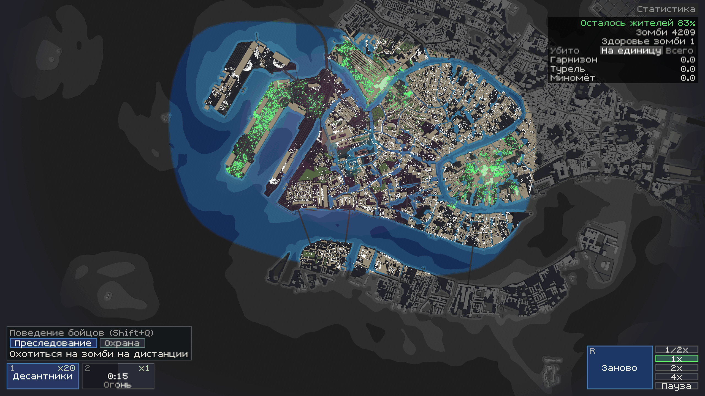
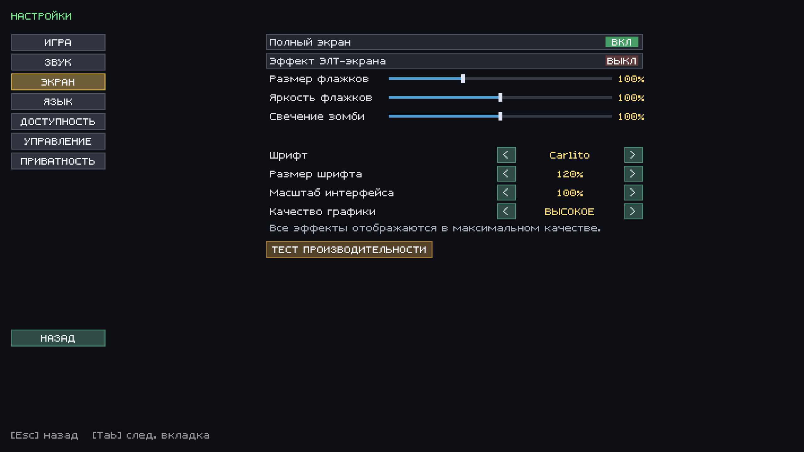
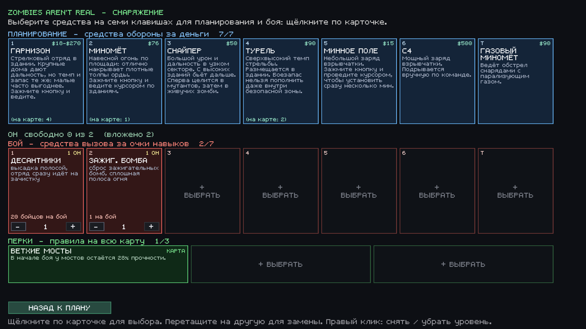

# Zombies Aren't Real - Русификатор

Полный русский текст (`3 009` строк), кастомный пиксельный шрифт 8x8 и гладкий Tactical HUD в настройках экрана без обрезки подписей.

- **[Полное издание 2-в-1 v1.3 (Русификатор + Мод-меню) на Boosty](https://boosty.to/cd_tixo/posts/0ec0506b-063f-4be2-a788-40ebe320add7?utm_source=github&utm_medium=readme&utm_campaign=zombies_arent_real)** *(рекомендуется - два модуля на выбор в одном установщике)*
- **[Скачать базовый русификатор v1.3 (ZIP)](https://github.com/neoru-droid/zombies-arent-real-ru/releases/download/v1.3.0/ZombiesArentReal-RU-v1.3.zip)** · [Как установить](#установка)

Проверено на патче 0.44.0 (сборка Steam `26799228`) для **Windows** и **Steam Deck / Linux**. Достижения Steam продолжают открываться, а кнопка удаления в любой момент возвращает оригинальные файлы.

## Установка
1. Закройте игру, распакуйте архив и запустите `ZombiesArentReal-RU-Setup.exe` -> **«Установить русификатор»**.
2. **Steam Deck / Linux:** распакуйте все файлы архива в одну папку и выполните `sh install-steamdeck.sh` рядом с `.exe`.
3. Кнопка **«Вернуть оригинал»** удаляет перевод в один клик. После обновлений игры запустите установку повторно. Совместимо с [внутриигровым мод-меню](https://github.com/neoru-droid/zombies-arent-real-trainer-ru) (оба модуля ставятся и удаляются независимо в любом порядке).

*(Окно SmartScreen на Windows: «Подробнее» -> «Выполнить в любом случае».)*

## Перевод мутаторов
В игре названия мутаторов остаются на английском из-за ограничения движка:
- **From the Edges** (С краёв карты): орда идёт с краёв карты волнами по нажатию «К БОЮ».
- **Inside the Walls** (За стенами): гарнизоны, снайперы, миномёты и турели ставятся только в безопасных зонах; +10% денег.
- **Landmark City** (Город ориентиров): вдвое больше особых зданий, но -35% денег за этап.
- **No Safe Zones** (Без безопасных зон): оборона только орудиями, минами и стенами; +25% очков навыков.
- **Recharging Arsenal** (Восполняемый арсенал): отряды на 40% дороже, но способности перезаряжаются.
- **Swimmer Season** (Сезон пловцов): втрое больше пловцов из котлов орды; +15% денег.
- **Tough Horde** (Живучая орда): у зомби 5 ед. здоровья в начале боя (предел 40 вместо 30); +35% денег.

## Скриншоты

Открыть игровые кадры

**Кампания и меню**

**Планирование обороны**

**Бой с ордой**

**Настройки и шрифты**

**Снаряжение и перки**

## История обновлений
- **[v1.3](https://github.com/neoru-droid/zombies-arent-real-ru/releases/tag/v1.3.0)** - обновление под патч `0.44.0` (сборка `26799228`): переведены 193 новые строки и обновлены 25 изменённых строк (коридоры эвакуации, подсказки удержания, новые кнопки сброса, Ганшип и правила кооператива).
- **[v1.2](https://github.com/neoru-droid/zombies-arent-real-ru/releases/tag/v1.2.0)** - исправлены описания снаряжения и подсказка гарнизона. Установщик обновляет текст и шрифты.
- **[v1.1](https://github.com/neoru-droid/zombies-arent-real-ru/releases/tag/v1.1.0)** - адаптация под патч игры `v0.43.1`, кнопка Boosty в установщике.
- **[v1.0](https://github.com/neoru-droid/zombies-arent-real-ru/releases/tag/v1.0.0)** - первый релиз перевода текста, пиксельного шрифта `8x8` и `Tactical HUD`.

[Все версии](https://github.com/neoru-droid/zombies-arent-real-ru/releases) · [Руководство в Steam](https://steamcommunity.com/sharedfiles/filedetails/?id=3840725363) · [Тема в Steam](https://steamcommunity.com/app/5185890/discussions/0/571554831822702858/) · [Парное мод-меню](https://github.com/neoru-droid/zombies-arent-real-trainer-ru)

## Поддержать
- **[Каталог релизов на Boosty](https://boosty.to/cd_tixo/posts/2a55d7e9-0f53-4d93-9f66-280981158dec?utm_source=github&utm_medium=readme&utm_campaign=zombies_arent_real)**
- **[Каталог всех игр с поиском](https://neoru-droid.github.io/)**

Перевод сделан нейросетью и проверен в игре. Найдёте опечатку или косяк - пишите в [Issues](https://github.com/neoru-droid/zombies-arent-real-ru/issues), поправлю.

## Другие переводы
- [Playrooms](https://github.com/neoru-droid/playrooms-ru)
- [Deleted Wiki: Clean Up the Lost Files](https://github.com/neoru-droid/deleted-wiki-ru)
- [Frontier Tale](https://github.com/neoru-droid/frontier-tale-ru)
- [We March as One](https://github.com/neoru-droid/we-march-as-one-ru)

Лицензия: [MIT](LICENSE) (шрифты в `data/fonts/` под SIL OFL 1.1)
