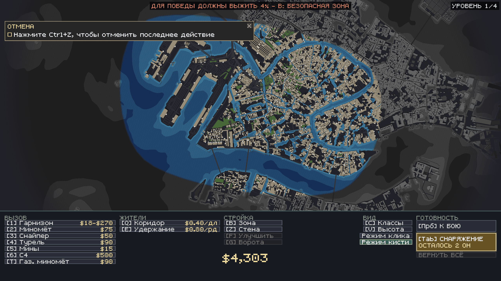

# Zombies Aren't Real: Русификатор

Русификатор текста, шрифтов и достижений для **Zombies Aren't Real** взамен сырого встроенного перевода.

**[Скачать русификатор (ZombiesArentReal-RU-v1.0.zip)](https://github.com/neoru-droid/zombies-arent-real-ru/releases/latest)**

## Что внутри

- **Исправленный текст:** убраны машинные кальки и забытые английские кнопки, выверены названия отрядов, улучшений, песочницы и редактора.
- **Родной пиксельный шрифт 8x8:** сделан под оригинал вместо мыльного офисного; в настройках («Экран -> Шрифт») также есть гладкий **Tactical HUD**.
- **14 достижений Steam:** переведены уведомления в Steam, а в установщике есть окно **«Достижения»** со списком и вашим прогрессом.

## Установка

- **Windows:** распакуйте архив, закройте игру, запустите `ZombiesArentReal-RU-Setup.exe` и нажмите **«Установить русификатор»** (если выскочит SmartScreen: «Подробнее» -> «Выполнить в любом случае», код открыт в репозитории). Кнопка **«Вернуть оригинал»** откатывает чистые файлы, а после патча игры просто запустите установку ещё раз.
- **Steam Deck / Linux:** распакуйте архив и запустите `install-steamdeck.sh` (рядом должен лежать `ZombiesArentReal-RU-Setup.exe`).

## Перевод встроенных мутаторов

Движок читает `mutators/*.ini` только в латинице и отбрасывает кириллицу, поэтому сами файлы не трогались ради работы режимов и таблиц лидеров. Перевод 7 режимов:

- **From the Edges** (С краёв карты) - орда идёт с краёв карты волнами, первая по нажатию «К БОЮ».
- **Inside the Walls** (За стенами) - гарнизоны, снайперы, миномёты и турели ставятся только внутри безопасных зон; +10% денег за этап.
- **Landmark City** (Город ориентиров) - вдвое больше особых зданий (до 4 на кв. км), но на 35% меньше денег за этап.
- **No Safe Zones** (Без безопасных зон) - без безопасных зон, оборона только орудиями, минами и стенами; +25% очков навыков.
- **Recharging Arsenal** (Восполняемый арсенал) - отряды на 40% дороже при планировании, но способности перезаряжаются после восстановления.
- **Swimmer Season** (Сезон пловцов) - котлы орды втрое чаще создают пловцов; +15% денег за этап.
- **Tough Horde** (Живучая орда) - 5 ед. здоровья у зомби в начале боя и предел 40 вместо 30; +35% денег за этап.

## Скриншоты

| Кампания и меню | Планирование обороны |
| :---: | :---: |
|  |  |

| Отражение атаки орды | Настройки и шрифты |
| :---: | :---: |
|  |  |

| Снаряжение и перки | Окно «Достижения» |
| :---: | :---: |
|  |  |

| Программа установки |
| :---: |
|  |

## Поддержать автора

- **[Отправить чаевые через CloudTips (СБП / карта)](https://pay.cloudtips.ru/p/240b8760)** или поставить звезду репозиторию.

Черновик перевода делался с нейросетью, потом вручную вычитан и проверен в игре. Опечатки и неточности кидайте в Issues или комментарии в Steam - поправлю.

## Другие переводы

- **We March as One: Русификатор** ([Steam](https://steamcommunity.com/sharedfiles/filedetails/?id=3840161059) · [GitHub](https://github.com/neoru-droid/we-march-as-one-ru))

## Лицензии

- Код и перевод: [MIT](LICENSE); шрифты в `data/fonts/`: SIL Open Font License 1.1.
- Фанатский перевод [`neoru-droid`](https://github.com/neoru-droid), файлов самой игры в репозитории нет.
