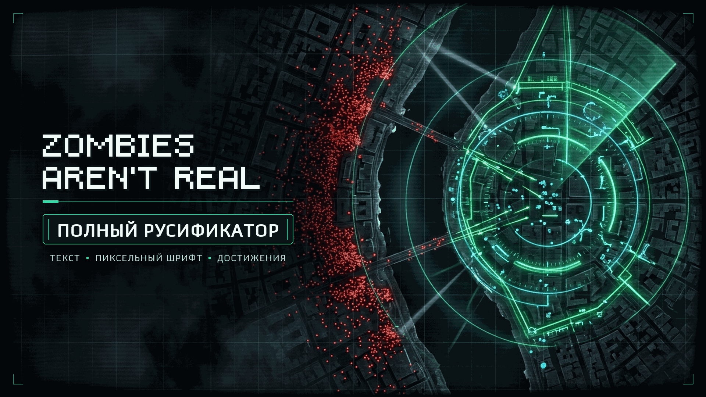
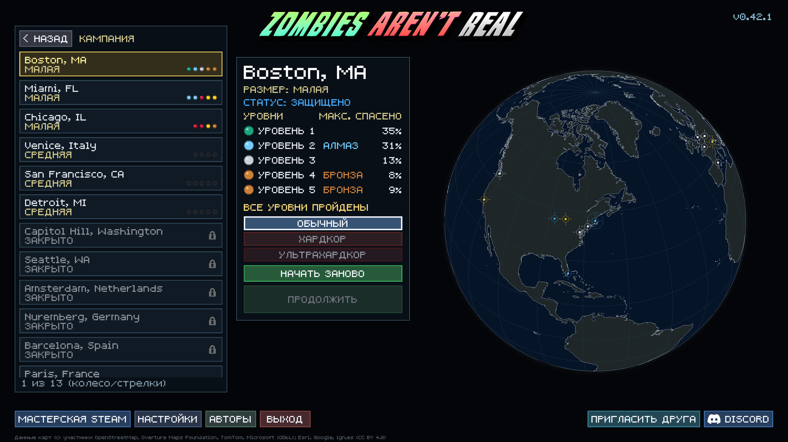

# Zombies Aren't Real: Русификатор

Полный русификатор текста, шрифтов и достижений для тактической стратегии **Zombies Aren't Real**. Исправляет сырой встроенный перевод из Steam, заменяет чужеродный офисный шрифт на родной пиксельный и переводит все достижения.

**[Скачать русификатор (ZombiesArentReal-RU-v1.0.zip)](https://github.com/neoru-droid/zombies-arent-real-ru/releases/latest)**

## Что исправлено по сравнению со встроенным переводом

- **Вычитан и исправлен весь игровой текст:** убраны машинные кальки, опечатки и забытые английские названия кнопок в подсказках, приведены в порядок названия отрядов, вооружения, обучения, песочницы и редактора карт.
- **Адаптирован шрифт под оригинал:** вместо чужеродного гладкого офисного шрифта сделан чёткий пиксельный шрифт 8x8 точь-в-точь в стиле английской версии. Дополнительно в настройках игры («Экран -> Шрифт») доступен аккуратный гладкий тактический шрифт Tactical HUD с переключением на лету.
- **Переведены все 14 достижений Steam:** всплывающие уведомления при получении приходят на русском языке, а прямо в программе установщика есть окно **«Достижения»**, где виден ваш реальный прогресс открытия из Steam с датами и условиями.
- **Безопасность сохранений и обновлений:** кампании, мутаторы, таблицы лидеров Steam и совместная игра работают штатно, а при выходе патчей игры русификатор аккуратно обновляет перевод поверх новой версии.

## Как установить

1. Скачайте архив `ZombiesArentReal-RU-v1.0.zip` и распакуйте его в любую папку.
2. Закройте игру (если хотите, чтобы всплывающие уведомления о новых достижениях в самом Steam сразу приходили на русском, перед установкой лучше полностью выйти из клиента через меню «Steam -> Выход»).
3. Запустите `ZombiesArentReal-RU-Setup.exe`. Папка с игрой обычно находится сама; если нет, укажите её кнопкой «Обзор...».
4. Нажмите **«Установить русификатор»**. В этом же окне в любой момент можно нажать кнопку **«Достижения»**, чтобы посмотреть условия всех 14 достижений и свой текущий прогресс.

*Про SmartScreen:* при первом запуске Windows может показать синее окно защиты SmartScreen, так как у установщика нет платной цифровой подписи. Нажмите **«Подробнее»** и **«Выполнить в любом случае»**. Весь исходный код программы открыт и лежит в этом репозитории.

## Перевод встроенных мутаторов

Движок игры читает файлы встроенных мутаторов (`mutators/*.ini`) только в базовой латинице (ASCII) и отбрасывает кириллицу, поэтому установщик не трогает их, чтобы не ломать названия и ежедневные испытания. Памятка по всем 7 режимам:

- **From the Edges** (С краёв карты) - внутри города вспышка не начинается: орда заходит с краёв карты волнами, первая идёт по нажатию «К БОЮ».
- **Inside the Walls** (За стенами) - гарнизоны, снайперов, миномёты и турели можно ставить только в зданиях внутри безопасных зон; каждый этап даёт +10% денег.
- **Landmark City** (Город ориентиров) - особых зданий вдвое больше (до 4 на кв. км вместо 2), но каждый этап даёт на 35% меньше денег.
- **No Safe Zones** (Без безопасных зон) - размечать безопасные зоны нельзя, удерживайте город только орудиями, минами и стенами; каждый этап даёт +25% очков навыков.
- **Recharging Arsenal** (Восполняемый арсенал) - отряды при планировании стоят на 40% дороже, но боевые способности перезаряжаются после восстановления.
- **Swimmer Season** (Сезон пловцов) - котлы орды втрое чаще превращают зомби в пловцов, пересекающих воду; каждый этап даёт +15% денег.
- **Tough Horde** (Живучая орда) - в начале боя у зомби 5 ед. здоровья вместо 1, а предел растёт до 40 вместо 30; каждый этап даёт +35% денег.

## Удаление и обновления игры

- Чтобы вернуть исходные файлы игры, запустите `ZombiesArentReal-RU-Setup.exe` и нажмите **«Вернуть оригинал»**. Программа восстановит чистые копии файлов из папки `ru_backup_orig`.
- Если в Steam выйдет обновление игры и часть перевода сбросится, просто запустите установщик ещё раз и нажмите **«Установить русификатор»**.

## Скриншоты

| Кампания и меню | Планирование обороны |
| :---: | :---: |
|  |  |

| Отражение атаки орды | Настройки и шрифты |
| :---: | :---: |
|  |  |

| Снаряжение и перки | Окно «Достижения» |
| :---: | :---: |
|  |  |

| Программа установки |
| :---: |
|  |

## Что в репозитории

- `src/`: исходный код программы установки и окна просмотра достижений на C#.
- `data/`: выверенный перевод игрового текста, всех 14 достижений Steam и справочник встроенных мутаторов.
- `data/fonts/`: пиксельный шрифт `Carlito.ttf` и гладкий тактический шрифт `Tactical_HUD.ttf`.
- [`LICENSE`](LICENSE): текст лицензий на код, перевод и шрифты.

## Поддержать автора

Русификатор полностью бесплатный. Если перевод пригодился и хочется сказать спасибо:
- **[Отправить чаевые через CloudTips (СБП / карта)](https://pay.cloudtips.ru/p/240b8760)**
- поставить звезду этому репозиторию на GitHub или оценить руководство в Steam.

Перевод подготовлен с помощью нейросети, после чего вычитан по единому словарю терминов, подогнан под размеры интерфейса и проверен в игре. Если заметите неточность или опечатку, напишите в раздел Issues или в комментарии к руководству в Steam, поправим.

## Лицензии

- Код установщика и текст перевода распространяются под лицензией [MIT](LICENSE), шрифты в папке `data/fonts/` распространяются под открытой лицензией SIL Open Font License 1.1 (подробности в файле [`LICENSE`](LICENSE)).
- Это неофициальный фанатский перевод (автор: [`neoru-droid`](https://github.com/neoru-droid)). Файлов самой игры в репозитории и в архиве релиза нет.
