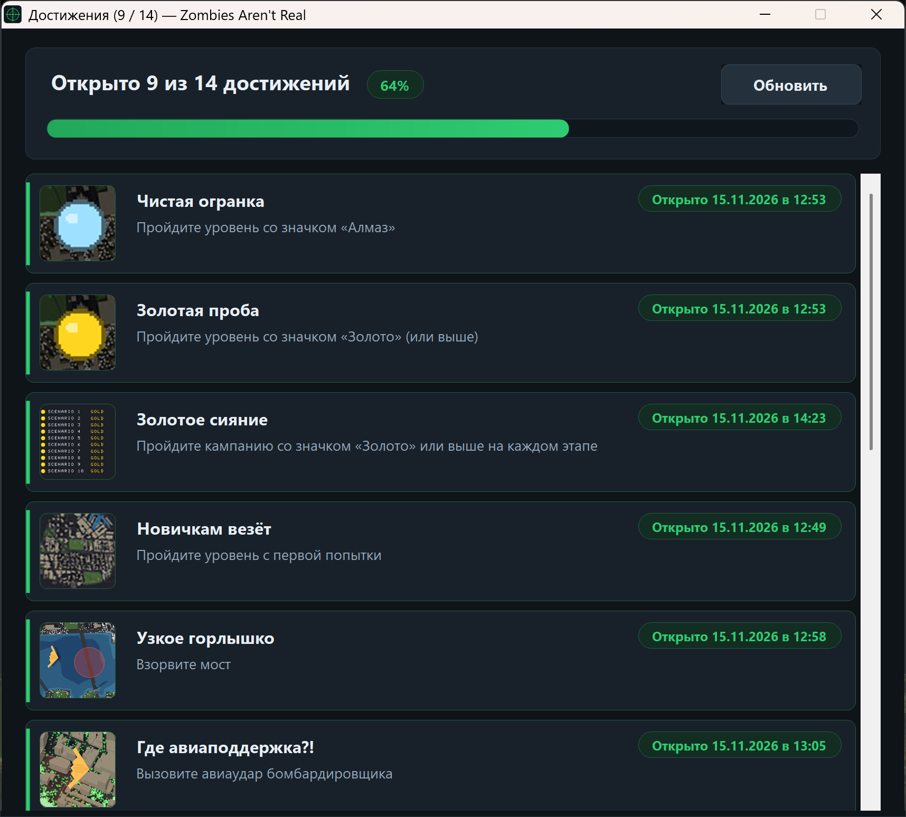
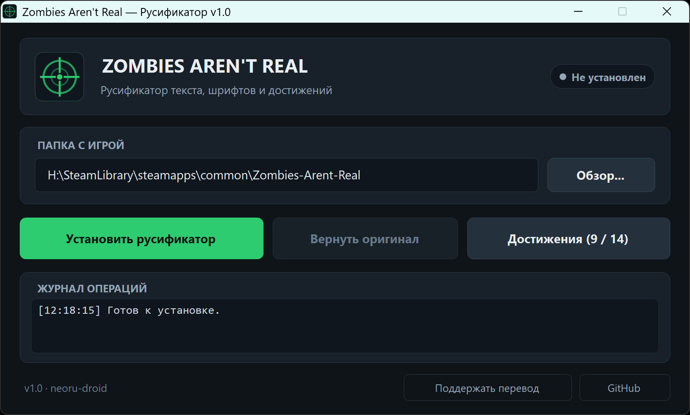

# Zombies Aren't Real: Русификатор

Исправленный русский перевод, пиксельный шрифт 8x8 (плюс гладкий **Tactical HUD** в настройках экрана) и перевод достижений для **Zombies Aren't Real**.

**[Скачать ZombiesArentReal-RU-v1.0.zip](https://github.com/neoru-droid/zombies-arent-real-ru/releases/latest)**

## Установка
1. Закройте игру, распакуйте архив и запустите `ZombiesArentReal-RU-Setup.exe` -> **«Установить русификатор»**.
2. **Steam Deck / Linux:** распакуйте архив и запустите `sh install-steamdeck.sh` рядом с `.exe`.
3. Кнопка **«Вернуть оригинал»** удаляет перевод. После обновлений игры запустите установку повторно.

*(Окно SmartScreen на Windows: «Подробнее» -> «Выполнить в любом случае».)*

## Перевод мутаторов
В игре названия мутаторов остаются на английском из-за ограничения движка:
- **From the Edges** (С краёв карты): орда идёт с краёв карты волнами по нажатию «К БОЮ».
- **Inside the Walls** (За стенами): гарнизоны, снайперы, миномёты и турели ставятся только в безопасных зонах; +10% денег.
- **Landmark City** (Город ориентиров): вдвое больше особых зданий, но -35% денег за этап.
- **No Safe Zones** (Без безопасных зон): оборона только орудиями, минами и стенами; +25% очков навыков.
- **Recharging Arsenal** (Восполняемый арсенал): отряды на 40% дороже, но способности перезаряжаются.
- **Swimmer Season** (Сезон пловцов): втрое больше пловцов из котлов орды; +15% денег.
- **Tough Horde** (Живучая орда): у зомби 5 ед. здоровья в начале боя (предел 40 вместо 30); +35% денег.

## Скриншоты

| Кампания и меню | Планирование обороны |
| :---: | :---: |
|  |  |

| Бой с ордой | Настройки и шрифты |
| :---: | :---: |
|  |  |

| Снаряжение и перки | Достижения |
| :---: | :---: |
|  |  |

| Установщик |
| :---: |
|  |

## Поддержать
- **[Чаевые через CloudTips (СБП / карта)](https://pay.cloudtips.ru/p/240b8760)**

Перевод сделан с нейросетью и вычитан в игре. Найдёте опечатку - пишите в [Issues](https://github.com/neoru-droid/zombies-arent-real-ru/issues), поправлю.

## Другие переводы
- [Frontier Tale](https://github.com/neoru-droid/frontier-tale-ru)
- [We March as One](https://github.com/neoru-droid/we-march-as-one-ru)

Лицензия: [MIT](LICENSE) (шрифты в `data/fonts/` под SIL OFL 1.1)
